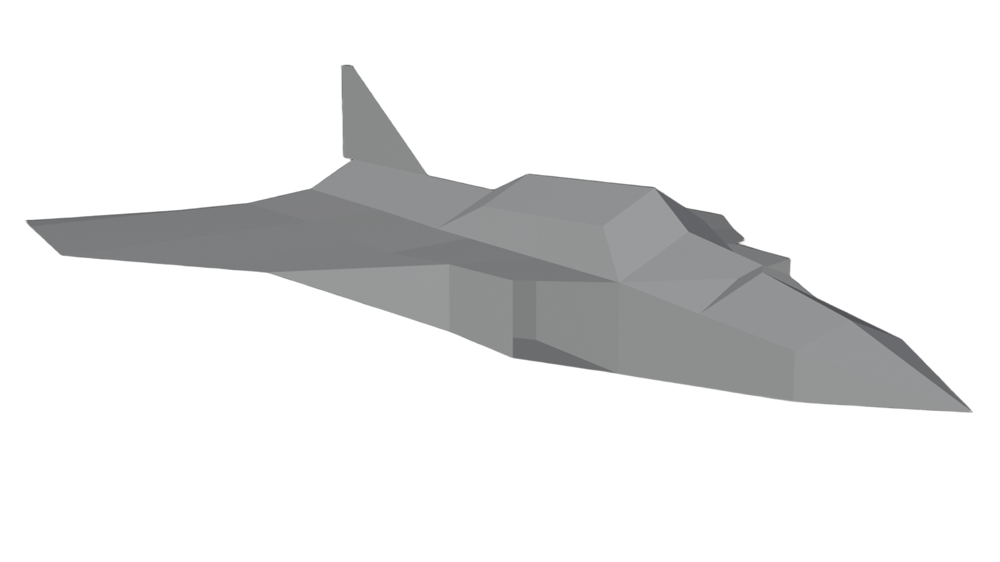

  
   
  <strong>JetGame</strong>
    
  A jet game made in unity 6000.3.26f1

<!--
## Installation

1. Download
2. Run
-->

<!-- ## Screenshots

Music

  
  

Music Library

  
  

Android Auto

  
  

Settings

  
  

 -->
